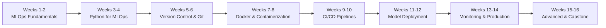

# AI-ML training materials 

**Comprehensive syllabus for freshers: building a career in Machine Learning Operations**

A 16-week intensive coaching program that takes freshers from ML and MLOps fundamentals to production deployment. The curriculum bridges the gap between machine learning and software engineering.

---
## Table of contents

- [Learning outcomes](#learning-outcomes)
- [Prerequisites](#prerequisites)
- [Course structure](#course-structure)
- [Roadmap](#roadmap)
- [Curriculum](#curriculum)
- [Assessment and evaluation](#assessment-and-evaluation)
- [Tools and technologies](#tools-and-technologies)
- [Career outcomes](#career-outcomes)
- [Learning resources](#learning-resources)

---

## Learning outcomes

By the end of the program you will be able to:

- Understand ML fundamentals and MLOps principles
- Master Python programming and version control
- Build containerized applications with Docker
- Implement CI/CD pipelines for ML projects
- Deploy and serve ML models in production
- Monitor, log, and maintain ML systems
- Implement ML infrastructure best practices

## Prerequisites

- Basic programming knowledge
- Understanding of the command line
- Basic Python familiarity
- Basic Git concepts
- Understanding of how ML models work

## Course structure

| | |
|---|---|
| **Duration** | 16 weeks (20-25 hours per week) |
| **Format** | Live sessions + self-paced modules + hands-on projects |

## Roadmap

## Curriculum

| Weeks | Module | Topics | Key project |
|---|---|---|---|
| 1-2 | MLOps Fundamentals | What is MLOps, ML lifecycle, model training vs deployment, why MLOps matters | Environment setup |
| 3-4 | Python for MLOps | Python basics, NumPy & Pandas, data manipulation, virtual environments | Data cleaning project |
| 5-6 | Version Control & Git | Git fundamentals, GitHub workflow, branching strategies, pull requests | Git workflow project |
| 7-8 | Docker & Containerization | Docker basics, Dockerfile creation, multi-stage builds, Docker Compose | Containerize ML app |
| 9-10 | CI/CD Pipelines | GitHub Actions, pipeline design, testing automation, code quality | Build ML CI/CD |
| 11-12 | Model Deployment | FastAPI, model serialization, API versioning, load balancing | Deploy model as API |
| 13-14 | Monitoring & Production | Logging, monitoring, performance tracking, Infrastructure as Code | Monitoring setup |
| 15-16 | Advanced & Capstone | Model registry, feature stores, A/B testing, security, career prep | Capstone project |

### Module details

#### Weeks 1-2: MLOps Fundamentals
- What is MLOps
- ML lifecycle
- Model training vs deployment
- Why MLOps matters

**Key project:** Environment setup

#### Weeks 3-4: Python for MLOps
- Python basics
- NumPy and Pandas
- Data manipulation
- Virtual environments

**Key project:** Data cleaning project

#### Weeks 5-6: Version Control & Git
- Git fundamentals
- GitHub workflow
- Branching strategies
- Pull requests

**Key project:** Git workflow project

#### Weeks 7-8: Docker & Containerization
- Docker basics
- Dockerfile creation
- Multi-stage builds
- Docker Compose

**Key project:** Containerize ML app

#### Weeks 9-10: CI/CD Pipelines
- GitHub Actions
- Pipeline design
- Testing automation
- Code quality

**Key project:** Build ML CI/CD

#### Weeks 11-12: Model Deployment
- FastAPI
- Model serialization
- API versioning
- Load balancing

**Key project:** Deploy model as API

#### Weeks 13-14: Monitoring & Production
- Logging
- Monitoring
- Performance tracking
- Infrastructure as Code

**Key project:** Monitoring setup

#### Weeks 15-16: Advanced & Capstone
- Model registry
- Feature stores
- A/B testing
- Security
- Career prep

**Key project:** Capstone project

## Assessment and evaluation

| Component | Weight |
|---|---|
| Weekly coding assignments | 40% |
| Mini-projects per module | 30% |
| Final capstone project | 20% |
| Participation and code reviews | 10% |

## Tools and technologies

| Area | Tools |
|---|---|
| Core | Python, Git, Docker, GitHub Actions, FastAPI, PostgreSQL |
| Cloud | AWS (EC2, S3, Lambda); Google Cloud (optional) |
| Monitoring | Prometheus, Grafana, ELK Stack |
| ML frameworks | Scikit-learn, TensorFlow, PyTorch |

## Career outcomes

Graduates can pursue roles such as:

- MLOps Engineer
- Machine Learning Engineer
- Data Engineer
- DevOps Engineer (ML focus)
- ML Platform Engineer

## Learning resources

- Official documentation and tutorials
- Real-world projects and open source
- Industry case studies
- Weekly live Q&A sessions
- Mentorship from professionals
- Doubt resolving
